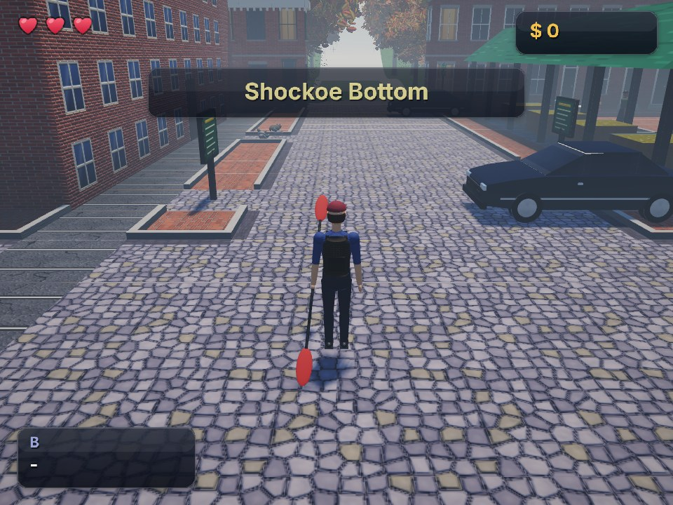
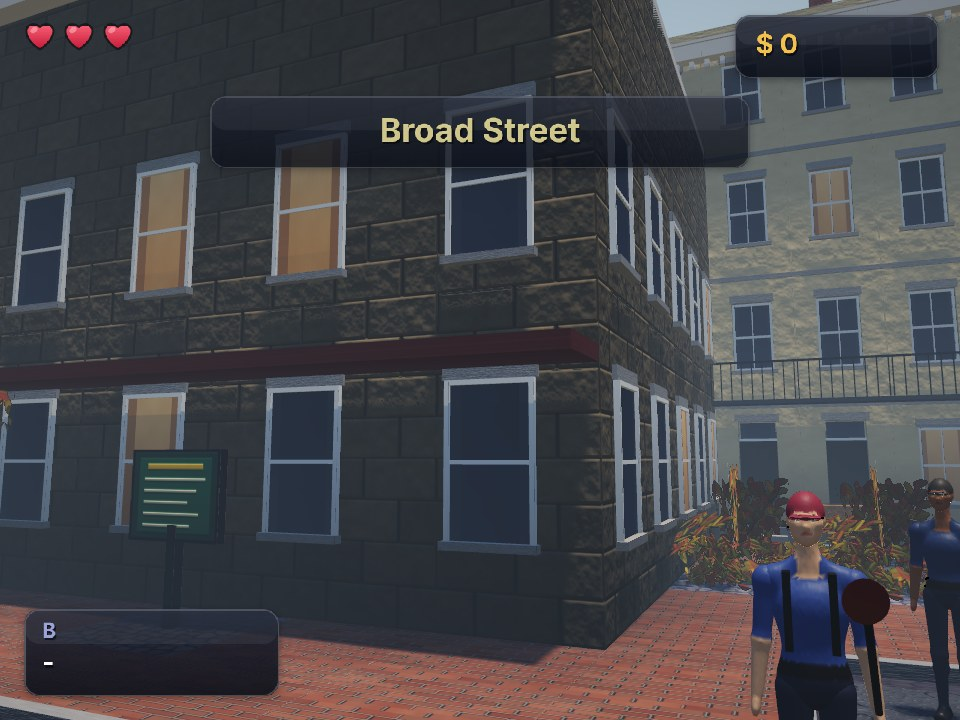
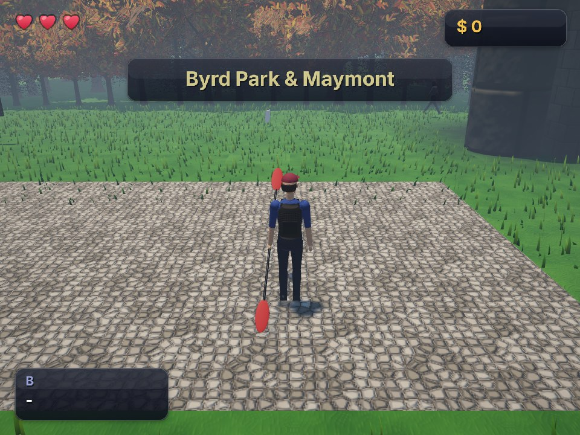
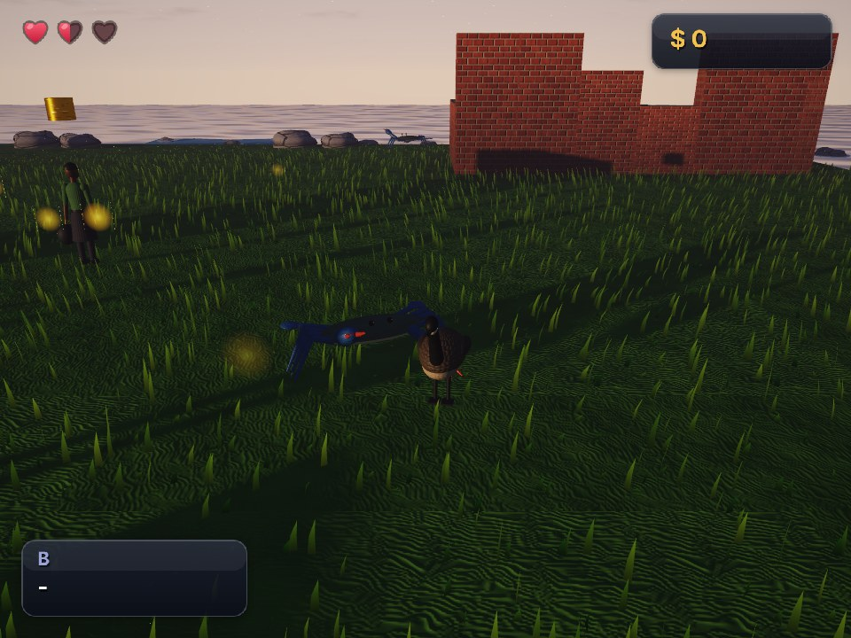

# River City Quest

**Play it: https://doodersrage.github.io/river-city-quest-modern/**

The modern 3D version of [River City Quest](https://github.com/doodersrage/river-city-quest), the Zelda-like adventure set in Richmond, Virginia. A cold fog has rolled up off the James and the gas lamps are going dark. The archivist at the Capitol needs four keystones to open the old Church Hill Tunnel, where something is waiting under the hill.

It's the same game as the [PS1-style version](https://github.com/doodersrage/river-city-quest-3d) (all 24 neighborhoods, seven dungeons and bosses, the mini-games, the dog, fishing, weather and events) rebuilt to look real: real-world proportions and materials, and a physically based renderer.

| | |
|---|---|
|  |  |
|  |  |
|  |  |
|  | |

## The look

- **Sculpted people:** bodies are modeled like a sculptor blocks out anatomy (shoulders, chest, hips, calves, hands, and faces with brows, cheekbones, nose, lips, ears and set-in eyes), blended into one smooth surface, at real adult proportions. Men and women have different builds, and clothes, skin and hair blend at their edges.
- **Motion-captured movement:** people are one skinned body on a 13-bone skeleton, so knees, elbows, hips and shoulders bend. Walking and running are real human motion from the Carnegie Mellon motion capture library; standing still has breathing and slow weight shifts.
- **Real trees and plants:** oaks, maples and pines with forked trunks and crowns built from thousands of leaves, which cast dappled shadows. Mulched flower beds, shrubs and lumpy boulders. The leaves follow the real calendar.
- **Richmond's streets:** cobblestones in Shockoe Bottom and on Church Hill, asphalt with trolley rails on Broad Street, brick sidewalks with granite curbs in the old neighborhoods, and gravel paths in the parks.
- **Buildings at real scale:** 3.3-meter stories. Windows and doors are real openings in the wall with reveals, set-back frames and glass, granite sills and lintels; doors are paneled with transoms over stone stoops; shop fronts have awnings and sign bands; walls have base courses, belt courses, bracketed cornices and downspouts. The buildings you can walk into and the big landmarks get the same treatment.
- **Animals as they look:** Norway rats, gray squirrels, Canada geese, blue crabs, brown bats, rock pigeons and a snapping turtle, plus half-seen, translucent ghosts. Parked cars are proper sedans.

- **Physically based materials:** brick, cobblestone, slate, wood, marble and grass are painted at full resolution with surface relief, roughness and metalness, and lit with real specular highlights.
- **A sun that moves:** it rises and sets with the game clock and casts soft real-time shadows. At night the moon takes over, windows glow, and the lantern and gas lamps light the streets.
- **Sky and atmosphere:** a sky with drifting clouds and stars, haze that glows toward the sun, and rain, fog and snow that change the light.
- **The James:** moving waves that reflect the sky, with sun glints by day and lamplight by night. The river and the land carry on past the edge of each neighborhood into wooded hills.
- **Grass and shading:** thousands of grass blades sway around you, and the ground darkens where it meets walls.
- **HDR and bloom** with filmic tone mapping, plus anti-aliasing.
- **Automatic quality:** the game watches its own frame rate and steps shadows, effects and resolution down until it runs smoothly. Phones start at Medium. You can pick Low, Medium, High or Auto under SYSTEM in the pause menu.

There's no 3D library: it's hand-written WebGL 2.

## Controls

| | Keyboard | Gamepad | Touch |
|---|---|---|---|
| Move | WASD or arrows | Left stick | Stick |
| Talk, read, open, swing | J, Space or Z | A | A |
| Use item | K, Shift or X | B / X | B |
| Switch item | L, Tab or C | Y / RB | ITEM |
| Camera | Q and E | Right stick, LT / RT | Drag on the right |
| Menu | Enter or Esc | Start | MENU |

## How it's built

Plain JavaScript and WebGL 2, no build step and no libraries. The scripts load in order from `index.html` and share one global scope.

- `js/data.js`: the places, people, stories, buildings and dungeons, imported from the 2D game by `tools/import-2d.js`. Don't edit it by hand.
- `js/mesh.js`: geometry helpers, with normals on every vertex
- `js/tex.js`, `js/tex2.js`: the materials, painted in code at startup into texture arrays with normal and roughness maps
- `js/level.js`: turns a 2D tile map into a 3D place
- `js/models.js`: low-poly people, creatures and props
- `js/game.js`: the game itself, with no drawing in it
- `js/talk.js`: what everyone says
- `js/life.js`: the dog, food, fishing, photos, the bike, weather, seasons and events
- `js/mini.js`: the mini-games and their sets
- `js/gfx.js`: the renderer: lighting, shadows, sky, water, grass, bloom and quality levels
- `js/render.js`: posing and drawing the people, creatures, props and glows
- `js/hud.js`: hearts, dialog windows, the pause menu and the title
- `js/input.js`, `js/audio.js`, `js/main.js`: controls, sound and the frame loop

To pull fresh data from the 2D game, check both repos out side by side and run:

```
node tools/import-2d.js ../river-city-quest
```

## Tests

```
node tests/run.js
```

The tests load the game into Node without a screen. `playthrough.test.js` has a bot play the opening: get the lantern, walk to Belle Isle, clear the quarry, unlock the door, blow the wall, beat Old Snapper and bring the keystone home. `dungeons.test.js` checks that every door goes somewhere, every dungeon room connects to its entrance, and a bot beats all seven bosses through to the credits. `puzzles.test.js` uses each item on the puzzle it's for. `mini.test.js` has a bot play every mini-game to the end, and `life.test.js` covers the dog, cooking, fishing, photos, the bike, stashes, weather, frogs and First Friday. `camera.test.js` walks out of every building and checks the camera can see you. `modern.test.js` checks the normals, the contact shading and the automatic quality levels. `features.test.js` covers markers, all four challenges, bushes, nighttime, dying and the menu. GitHub Actions runs them on every push.

## Credits

The walk and run animations were baked from the CMU Graphics Lab Motion Capture Database by `tools/bake-mocap.js` (BVH conversion by Bruce Hahne). The data used in this project was obtained from mocap.cs.cmu.edu. The database was created with funding from NSF EIA-0196217.
