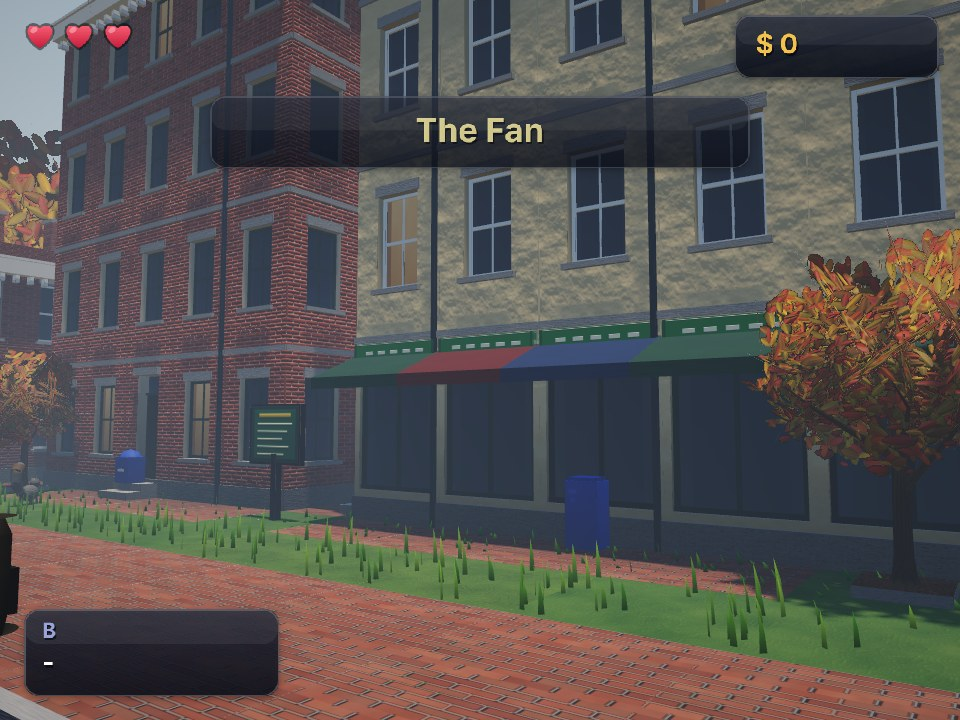
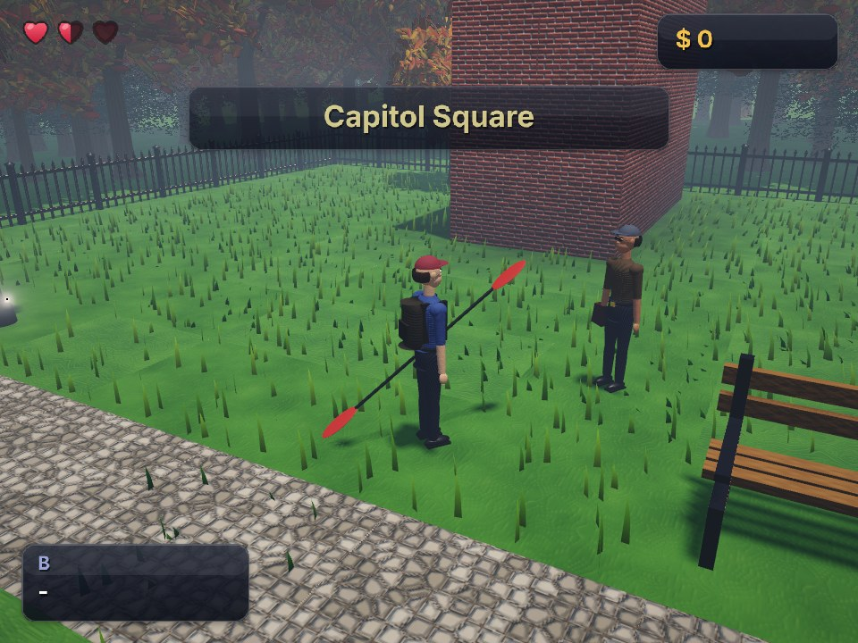
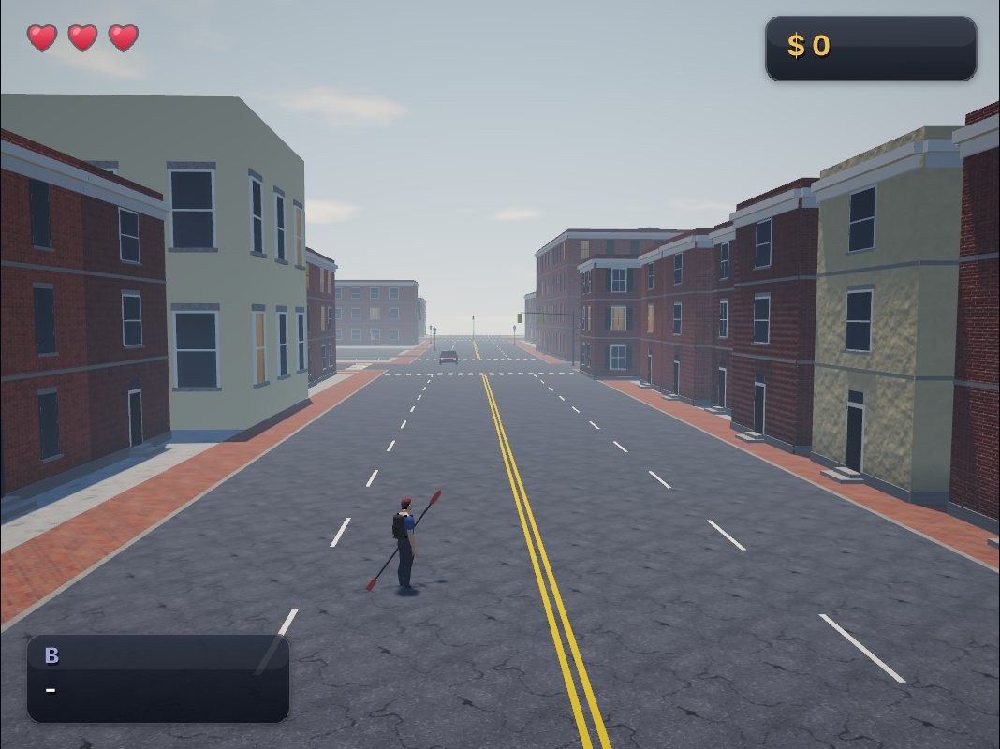
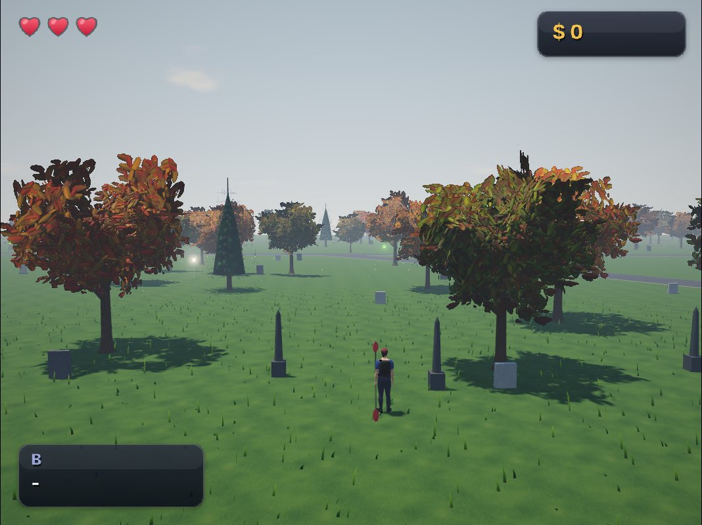
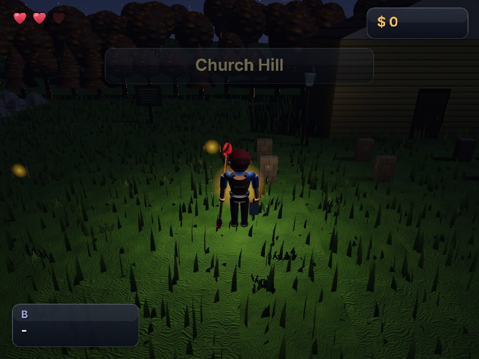
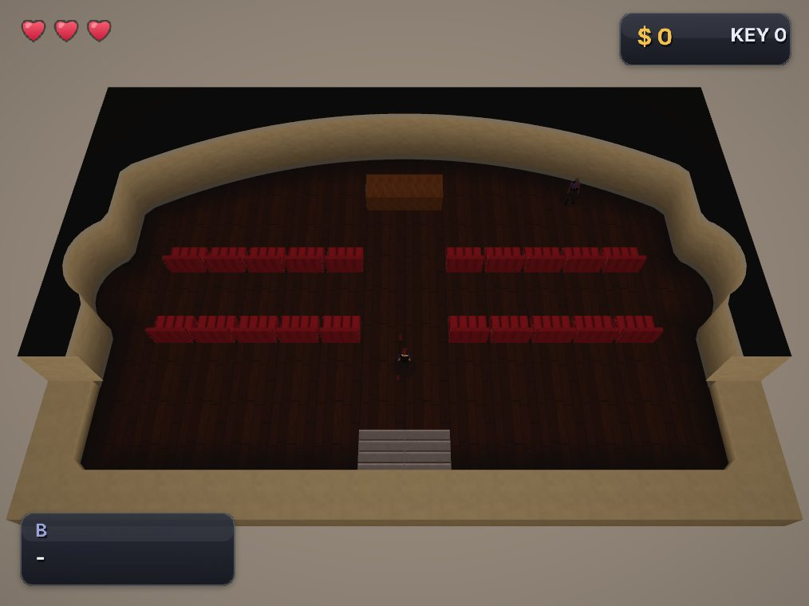
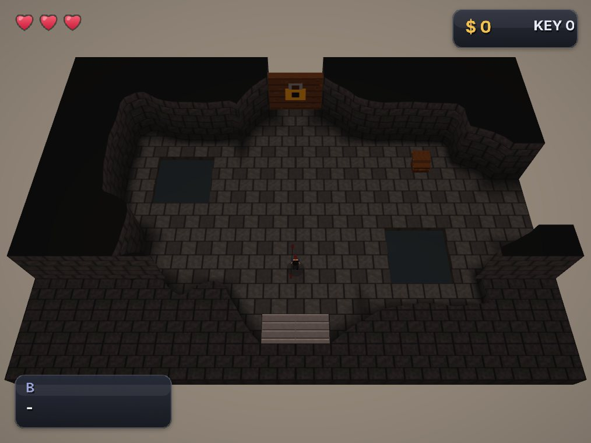

# River City Quest

**Play it: https://doodersrage.github.io/river-city-quest-modern/**

The modern 3D version of [River City Quest](https://github.com/doodersrage/river-city-quest), the Zelda-like adventure set in Richmond, Virginia. A cold fog has rolled up off the James and the gas lamps are going dark. The archivist at the Capitol needs four keystones to open the old Church Hill Tunnel, where something is waiting under the hill.

It's the same game as the [PS1-style version](https://github.com/doodersrage/river-city-quest-3d) (all 24 neighborhoods, seven dungeons and bosses, the mini-games, the dog, fishing, weather and events) rebuilt to look real: real-world proportions and materials, and a physically based renderer.

| | |
|---|---|
|  |  |
|  |  |
|  |  |

## The look

- **Real human bodies:** people are Blender Studio's realistic Human Base Meshes (public domain), a man and a woman of about 16,000 points each, with real faces, hands and musculature. One body is shared by everyone; each person brings their own skin tone, clothes, hair color and height. Shirts and trousers are relaxed and pushed out so cloth hangs instead of clinging, hair grows from the scalp, and caps and shoes are sculpted to fit.
- **Motion-captured movement:** people are one skinned body on a 13-bone skeleton, so knees, elbows, hips and shoulders bend. Walking and running are real human motion from the Carnegie Mellon motion capture library; standing still has breathing and slow weight shifts.
- **Animals that move like animals:** every creature has its own small skeleton. Rats trot on four jointed legs and stop to sniff; squirrels bound with an arching back and sit up to stare; geese waddle, graze, then lower their necks and charge with wings out; crabs sidle on rippling legs with claws raised and snapping; bats and the raven beat two-jointed wings; the snapping turtle crawls and pulls its neck in before it lunges. Nothing starts or turns in an instant.
- **Landmarks built like the real ones:** the Virginia State Capitol is Jefferson's temple with an Ionic portico two columns deep, pilastered walls and the 1906 wings; Main Street Station has its stone arcade, brick upper floors, steep tiled roof with dormers, four-faced clock tower with open belvedere, and the train shed; St. John's is the white frame church with green shutters and a three-stage steeple; the Carillon is the Georgian brick tower with stone corners, open belfry, balustrade, lantern and dome; the Byrd Theatre has its marquee, blade sign, ticket booth and arched terracotta windows.
- **Neighborhoods that look like themselves:** the Fan is brick rowhouses in their own colors with full front porches on round columns, railings, tin porch roofs and slate false mansards with dormers; Jackson Ward has cast-iron porches with lace brackets and deep bracketed cornices; Shockoe is warehouses with corbelled brick cornices, low brick arches over the windows, iron shutters and star bolts; Carytown is painted storefronts under striped awnings with stepped parapets; Scott's Addition and Manchester are factories with wide steel sash windows.
- **Bigger neighborhoods:** every outdoor map is twice as wide and twice as deep as in the original game (about 128 by 88 m). The original layout sits in the middle; in town a street rings it and new blocks, alleys, street trees and lamps fill out to the edge, and in parks and on the river the open ground carries on. Roads leave each map where they always did, so neighborhoods still join. The level is drawn in 16 m pieces and only the ones in view are sent to the graphics card.
- **Real streets around the landmarks:** six districts are laid out by hand after the streets that really bound their landmarks, in the right order and with their real names: Capitol Square inside Ninth, Broad, Governor and Bank, with Old City Hall across Broad and St. Paul's across Ninth; Main Street Station on East Main at 15th with the 17th Street Market to the east; St. John's between Broad and Grace, 24th and 25th; the Byrd on West Cary between Sheppard and Colonial; Monument Avenue between Grace and Park; the Hippodrome on Second Street between Clay and Leigh. Green signs stand at the corners, the street you are on is shown at the bottom of the screen, and plaques mark real neighbors. Distances are compressed: a map is about one real block across.
- **Made to be walked:** keep moving on a clear street and the jog opens into a run, half again as fast; it drops when you stop, swing or meet trouble. The first time you walk each named street it is counted and pays a few coins. Neighbors stand out on the named streets and tell you where you are, enemies roam the back streets, and each map hides two more stashes on the new ground. The GRTC bus on the map screen still takes you to any neighborhood you have visited.
- **Streets that look used:** asphalt streets carry a double yellow centre line, broken white lane lines and zebra crossings at the corners; the big crossings have traffic signals on mast arms; cars are parked parallel to the curb on streets running either way, clear of the corners, and nose-in in painted bays in the parking lots.
- **A city that moves:** cars drive the streets on the right, keep their distance, stop at red lights and wait for anyone crossing in front of them; the signals run on one cycle and their lamps are lit to match. People walk the sidewalks. Street signs carry their real names, shops have lettered signs, and the Byrd's marquee and blade sign are lettered. Each house has its own kind of window; flat roofs collect air conditioners, vents, skylights, stair bulkheads and the odd water tank; tall walls carry iron fire escapes; wooden utility poles and sagging wires run along alleys and side streets; no two trees are the same shade; and the air is clear enough to see down the street.
- **Real trees and plants:** oaks, maples and pines with forked trunks and crowns built from thousands of leaves, which cast dappled shadows. Mulched flower beds, shrubs and lumpy boulders. The leaves follow the real calendar.
- **Richmond's streets:** cobblestones in Shockoe Bottom and on Church Hill, asphalt with trolley rails on Broad Street, brick sidewalks with granite curbs in the old neighborhoods, and gravel paths in the parks.
- **Buildings at real scale:** 3.3-meter stories. Windows and doors are real openings in the wall with reveals, set-back frames and glass, granite sills and lintels; doors are paneled with transoms over stone stoops; shop fronts have awnings and sign bands; walls have base courses, belt courses, bracketed cornices and downspouts. The buildings you can walk into and the big landmarks get the same treatment.
- **Animals as they look:** Norway rats, gray squirrels, Canada geese, blue crabs, brown bats, rock pigeons and a snapping turtle, plus half-seen, translucent ghosts. Parked cars are proper sedans.

- **Physically based materials:** brick, cobblestone, slate, wood, marble and grass are painted at full resolution with surface relief, roughness and metalness, and lit with real specular highlights.
- **A sun that moves:** it rises and sets with the game clock and casts soft real-time shadows. At night the moon takes over, windows glow, and the lantern and gas lamps light the streets.
- **Sky and atmosphere:** a sky with drifting clouds and stars, haze that glows toward the sun, and rain, fog and snow that change the light.
- **The James:** moving waves that reflect the sky, with sun glints by day and lamplight by night. The river and the land carry on past the edge of each neighborhood into wooded hills.
- **Grass and shading:** thousands of grass blades sway around you, and the ground darkens where it meets walls.
- **HDR and bloom** with filmic tone mapping, plus anti-aliasing.
- **Automatic quality:** the game watches its own frame rate and steps shadows, effects and resolution down until it runs smoothly. Phones start at Medium. You can pick Low, Medium, High or Auto under SYSTEM in the pause menu.

There's no 3D library: it's hand-written WebGL 2.

## Controls

| | Keyboard | Gamepad | Touch |
|---|---|---|---|
| Move | WASD or arrows | Left stick | Stick |
| Talk, read, open, swing | J, Space or Z | A | A |
| Use item | K, Shift or X | B / X | B |
| Switch item | L, Tab or C | Y / RB | ITEM |
| Camera | Q and E | Right stick, LT / RT | Drag on the right |
| Menu | Enter or Esc | Start | MENU |

## Real streets, real buildings

Outdoors, the game no longer sits on a grid of squares. Each of the 24 neighborhoods is 400 by 300 metres of the real place, taken from OpenStreetMap: every building stands on its own footprint at its real angle and height, every street is a line with its real width, name and one-way direction, and parks, parking lots, footpaths, fences, rail lines, bridges and the river bank are where they really are. Landmarks from the original game (the Capitol, Main Street Station, St. John's, the Byrd, the Carillon and the rest) are set on the footprints of the real buildings.

- Collision follows the real shapes. You can walk any alley that is really there, at any angle.
- Everything from the original game (people, doors, chests, enemies, plaques, challenges) was moved onto real ground that connects to the rest of the neighborhood; a test walks every district to prove each one can be reached.
- Cars follow the real street lines, keep right, stop at lights and wait for you. Parked cars sit along real curbs.

## Free-form rooms

Indoors, every room used to be the same 16 by 11 box. Now each of the 55 rooms and dungeon chambers has its own floor plan: the Capitol is a rotunda, St. John's has an apse, the pyramid's chambers narrow, the quarry and the tunnel are ragged caves, houses are L-shaped or have a slanted wall, and plain walls get curved bays. Pillars are round.

- A room's outline is a distance field (`js/roomplan.js`). The floor, walls and wall tops are traced from it, and collision uses the same field, so walls can curve or run at any angle.
- Each room picks the strongest shape that still leaves every person, chest, switch, block and way out on open floor, with everything that could be walked to before still walkable. A test checks all 55.
- Squares remain only as a notebook for puzzles (which square a block or switch is on). Pools and pits still have straight edges.

| | |
|---|---|
|  |  |

The map data is fetched by a GitHub Action (`.github/workflows/osm.yml`, run it from the Actions tab), which saves the raw download on the `osm-raw` branch. `node tools/osm/build.js <folder of raw files>` turns that into `js/worlddata.js`. District centres are in `tools/osm/districts.json`.

## How it's built

Plain JavaScript and WebGL 2, no build step and no libraries. The scripts load in order from `index.html` and share one global scope.

- `js/data.js`: the places, people, stories, buildings and dungeons, imported from the 2D game by `tools/import-2d.js`. Don't edit it by hand.
- `js/mesh.js`: geometry helpers, with normals on every vertex
- `js/tex.js`, `js/tex2.js`: the materials, painted in code at startup into texture arrays with normal and roughness maps
- `js/level.js`: turns a 2D tile map into a 3D place (rooms and dungeons)
- `js/worlddata.js`: the real neighborhoods, built from OpenStreetMap by `tools/osm/build.js`. Don't edit it by hand.
- `js/world.js`: reads that data, answers what is where (wall, water, street), and moves the original game's content onto the real ground
- `js/worldmesh.js`: builds what you see outdoors: ground, water, streets, buildings, landmarks, trees and street furniture
- `js/traffic.js`: cars, signals and people walking
- `js/roomplan.js`: the free-form floor plan of each room and dungeon chamber
- `js/models.js`: low-poly people, creatures and props
- `js/game.js`: the game itself, with no drawing in it
- `js/talk.js`: what everyone says
- `js/life.js`: the dog, food, fishing, photos, the bike, weather, seasons and events
- `js/mini.js`: the mini-games and their sets
- `js/gfx.js`: the renderer: lighting, shadows, sky, water, grass, bloom and quality levels
- `js/render.js`: posing and drawing the people, creatures, props and glows
- `js/hud.js`: hearts, dialog windows, the pause menu and the title
- `js/input.js`, `js/audio.js`, `js/main.js`: controls, sound and the frame loop

To pull fresh data from the 2D game, check both repos out side by side and run:

```
node tools/import-2d.js ../river-city-quest
```

## Tests

```
node tests/run.js
```

The tests load the game into Node without a screen. `playthrough.test.js` has a bot play the opening: get the lantern, walk to Belle Isle, clear the quarry, unlock the door, blow the wall, beat Old Snapper and bring the keystone home. `dungeons.test.js` checks that every door goes somewhere, every dungeon room connects to its entrance, and a bot beats all seven bosses through to the credits. `puzzles.test.js` uses each item on the puzzle it's for. `mini.test.js` has a bot play every mini-game to the end, and `life.test.js` covers the dog, cooking, fishing, photos, the bike, stashes, weather, frogs and First Friday. `camera.test.js` walks out of every building and checks the camera can see you. `modern.test.js` checks the normals, the contact shading and the automatic quality levels. `features.test.js` covers markers, all four challenges, bushes, nighttime, dying and the menu. GitHub Actions runs them on every push.

## Credits

Streets, buildings, parks and water are map data © [OpenStreetMap](https://www.openstreetmap.org/copyright) contributors, available under the Open Database License (ODbL).

The walk and run animations were baked from the CMU Graphics Lab Motion Capture Database by `tools/bake-mocap.js` (BVH conversion by Bruce Hahne). The data used in this project was obtained from mocap.cs.cmu.edu. The database was created with funding from NSF EIA-0196217.

The bodies are the Blender Studio Human Base Meshes v1.4.1 (CC0), rigged by the Castcut project and baked into `js/bodydata.js` by `tools/bake-body.js`. See `tools/bodies/LICENSE.md`.
